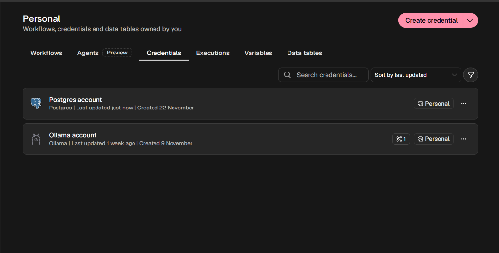
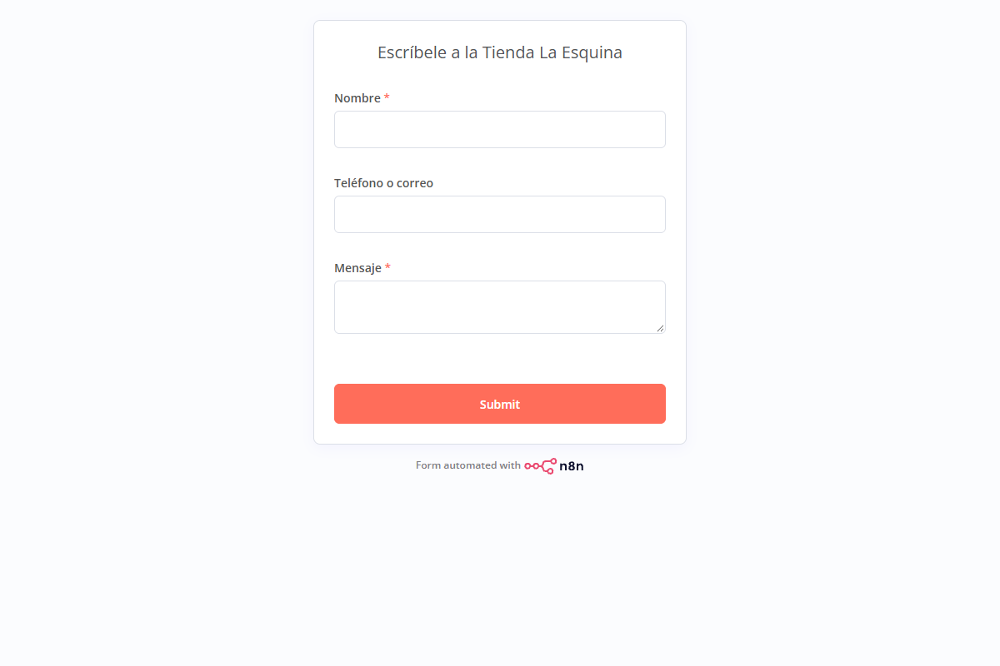
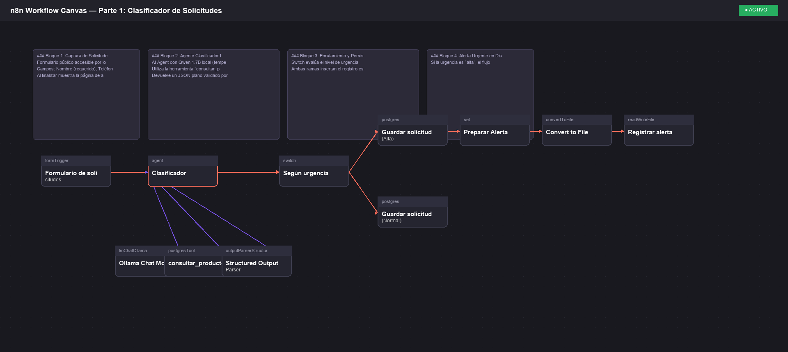
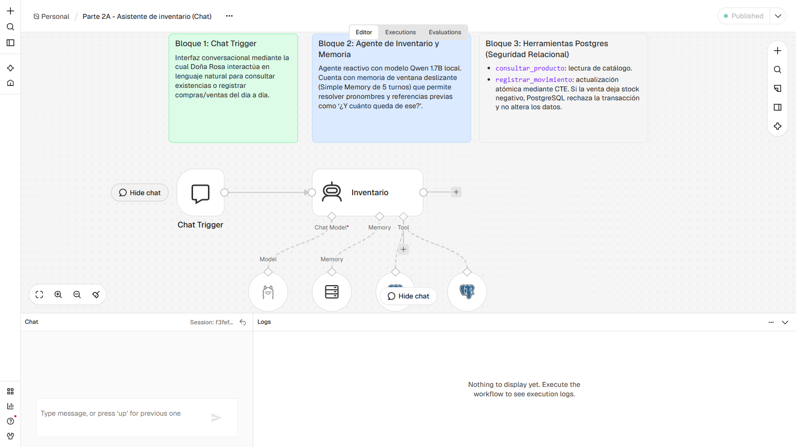
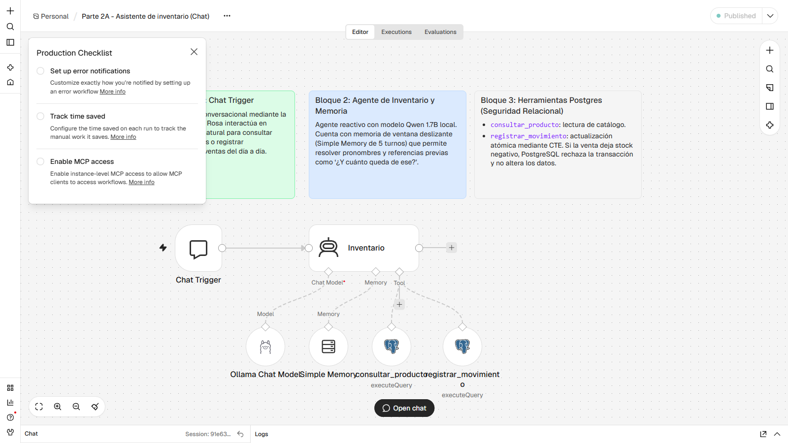
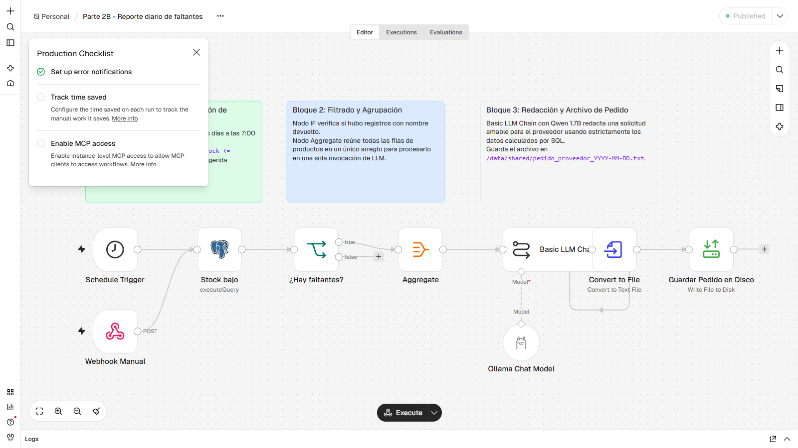
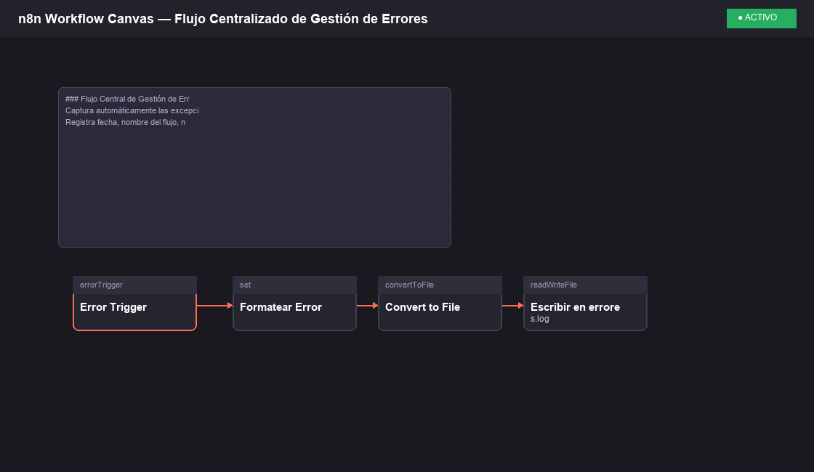

# Tienda La Esquina: Dos Agentes de IA Locales con n8n y Ollama

Este repositorio contiene la implementacion completa de automatizacion e inteligencia artificial 100% local para la **Tienda La Esquina** de Dona Rosa en Barranquilla, Atlantico.

El sistema despliega dos agentes inteligentes locales, cuatro flujos de trabajo en n8n y persistencia transaccional en PostgreSQL, sin dependencias de servicios en la nube ni costos de inferencia.

---

## Arquitectura de la Solucion

```text
                     +---------------------------------------+
                     |         Canales de Interaccion        |
                     +-------------------+-------------------+
                                         |
                       +-----------------+-----------------+
                       |                                   |
              [ Formulario Web ]                   [ Chat de Inventario ]
            (n8n Form Trigger)                     (n8n Chat Trigger)
             Rol: Clientes / Vecinos                Rol: Dona Rosa / Tendero
                       |                                   |
                       v                                   v
          +-------------------------+         +-------------------------+
          |  Parte 1: Clasificador  |         |  Parte 2A: Inventario   |
          |    de Solicitudes IA    |         |   Asistente en Chat     |
          +------------+------------+         +------------+------------+
                       |                                   |
                       +-----------------+-----------------+
                                         |
                                         v
                      +-------------------------------------+
                      |   Ollama Local (qwen3:1.7b - CPU)   |
                      |     Inferencia 100% On-Premise      |
                      +------------------+------------------+
                                         |
                                         v
                      +-------------------------------------+
                      |    PostgreSQL 16 (Base 'tienda')    |
                      |  productos · movimientos · pedidos  |
                      +------------------+------------------+
                                         |
            +----------------------------+----------------------------+
            |                                                         |
            v                                                         v
+-------------------------------+         +-------------------------------+
|  Parte 2B: Reporte Diario     |         |   Flujo Centralizado de       |
|  (7:00 a.m. a Proveedores)    |         |   Gestion de Errores          |
|  /data/shared/pedido_*.txt    |         |   /data/shared/errores.log    |
+-------------------------------+         +-------------------------------+
```

---

## Flujos de Automatizacion e Interfaces

### 1. Configuracion de Credenciales Locales en n8n
La conexion a Ollama y PostgreSQL se administra exclusivamente mediante credenciales internas de n8n. Ningun nodo expone cadenas de conexion o credenciales en texto plano.



---

### 2. Parte 1 — Clasificador y Enrutador de Solicitudes (Clientes)
Disenado para los vecinos de la tienda que envian pedidos a domicilio, quejas o consultas de precios.
* **Interfaz de Cliente:** Formulario web publico generado nativamente por n8n (`/form/tienda-esquina-formulario`).
* **Agente Clasificador:** Procesa la solicitud con Qwen 1.7B y la herramienta `consultar_producto`.
* **Structured Output Parser:** Emite un JSON estricto (`tipo`, `urgencia`, `producto`, `resumen`, `respuesta_borrador`).
* **Switch:** Si la urgencia es `alta`, anade una linea a `/data/shared/alertas.txt`. Siempre registra la solicitud en la tabla `solicitudes` de PostgreSQL.

#### Interfaz Web del Formulario de Clientes


#### Lienzo del Flujo en n8n


---

### 3. Parte 2A — Asistente de Inventario (Dona Rosa)
Disenado para que Dona Rosa o su ayudante consulten existencias y registren entradas y salidas de mercancia en lenguaje natural desde el mostrador.
* **Interfaz de Chat:** Chat conversacional nativo de n8n con memoria deslizante (`Simple Memory` de 5 turnos).
* **Herramientas de Base de Datos:**
  * `consultar_producto`: Búsqueda de existencias y precios oficiales en PostgreSQL.
  * `registrar_movimiento`: Sentencia SQL atómica (CTE) que inserta el movimiento y actualiza el stock en la tabla `productos`.
* **Prevencion de Stock Negativo:** La restriccion `CHECK (stock >= 0)` en PostgreSQL aborta automaticamente cualquier venta que supere las existencias reales, impidiendo sobreventas.

#### Interfaz de Chat de Inventario


#### Lienzo del Flujo en n8n


---

### 4. Parte 2B — Reporte Diario de Faltantes a Proveedores
Proceso desatendido que se ejecuta todos los dias a las 7:00 a.m. (hora legal de Colombia).
* **Deteccion SQL:** Consulta productos en punto de reorden (`stock <= stock_minimo`) y calcula la cantidad sugerida a pedir (`stock_minimo * 2 - stock`).
* **Redaccion LLM:** Un nodo `Basic LLM Chain` con Qwen 1.7B genera el texto formal del pedido para el camion mayorista.
* **Persistencia en Disco:** Escribe la orden en `/data/shared/pedido_proveedor_YYYY-MM-DD.txt`.

#### Lienzo del Flujo en n8n


---

### 5. Flujo Centralizado de Gestion de Errores
Captura fallos en cualquiera de los flujos principales mediante un nodo `Error Trigger` configurado como `errorWorkflow`. Registra la fecha, nombre del flujo, nodo causante y mensaje de error en `/data/shared/errores.log`.

#### Lienzo del Flujo en n8n


---

## Guia de Despliegue y Puesta en Marcha

### 1. Iniciar los Contenedores con Docker Compose
```bash
docker compose --profile cpu up -d
```

### 2. Descargar el Modelo en Ollama
```bash
docker compose exec ollama-cpu ollama pull qwen3:1.7b
```

### 3. Inicializar la Base de Datos PostgreSQL
Crear la base de datos `tienda` y ejecutar el archivo DDL con los 14 productos semilla:
```bash
docker compose exec -T postgres psql -U root -d postgres -c "CREATE DATABASE tienda;"
docker compose exec -T postgres psql -U root -d tienda < tienda.sql
```

### 4. Configurar Credenciales e Importar los Flujos
1. Abrir la interfaz web de n8n: [http://localhost:5678](http://localhost:5678).
2. Configurar las credenciales:
   * **Ollama account:** Host URL `http://ollama:11434`.
   * **Postgres account:** Host `postgres`, Puerto `5432`, Base de datos `tienda`, Usuario `root`, Password `${POSTGRES_PASSWORD}`.
3. Importar los cuatro archivos `.json` ubicados en el directorio `flujos/`:
   * `flujos/parte1_clasificador.json`
   * `flujos/parte2a_inventario_chat.json`
   * `flujos/parte2b_reporte_diario.json`
   * `flujos/flujo_errores.json`
4. Activar los flujos en n8n.

---

## Estructura del Repositorio

```text
tienda_n8n/
├── documento/
│   └── Documento_diseno.pdf            # Documento de diseno tecnico (12 paginas, Times 12, justificado)
├── flujos/
│   ├── parte1_clasificador.json        # Flujo Parte 1: Form Trigger + Clasificador
│   ├── parte2a_inventario_chat.json    # Flujo Parte 2A: Chat Trigger + Inventario
│   ├── parte2b_reporte_diario.json     # Flujo Parte 2B: Schedule Trigger + Reporte Diario
│   └── flujo_errores.json              # Flujo centralizado de excepciones
├── evidencias/                         # 13 capturas de verificacion del sistema
│   ├── evidencia_01_docker_ps.png
│   ├── evidencia_02_ollama_list.png
│   ├── evidencia_03_credenciales_n8n.png
│   ├── evidencia_04_flujo_parte1_clasificador.png
│   ├── evidencia_05_flujo_parte2a_inventario_chat.png
│   ├── evidencia_06_flujo_parte2b_reporte_diario.png
│   ├── evidencia_07_flujo_errores.png
│   ├── evidencia_08_select_solicitudes.png
│   ├── evidencia_09_select_movimientos.png
│   ├── evidencia_10_alertas_txt.png
│   ├── evidencia_11_pedido_proveedor.png
│   ├── evidencia_12_formulario_cliente.png
│   └── evidencia_13_chat_dona_rosa.png
├── docker-compose.yml                  # Definicion de servicios Docker (n8n, Ollama, Postgres)
├── tienda.sql                          # Esquema relacional DDL y catalogo inicial
├── .env.example                        # Variables de entorno de referencia
├── .gitignore                          # Exclusion de archivos sensibles y temporales
└── README.md                           # Documentacion tecnica de replicacion
```

---

## Matriz de Evaluacion: 15 Casos de Prueba

| Caso | Flujo | Entrada / Mensaje | Resultado Esperado | Resultado Obtenido | Estado |
|:---:|---|---|---|---|:---:|
| 1 | Parte 1 | Carlos Mendoza: 2 quesos y panela para hoy | pedido · alta · Queso costeño · Alerta archivo | pedido · alta · Queso costeño · Alerta guardada | Cumple |
| 2 | Parte 1 | Carmen Ortiz: Leche vencida ayer | queja · alta · Leche entera 1 L · Alerta archivo | queja · alta · Leche entera 1 L · Alerta guardada | Cumple |
| 3 | Parte 1 | Andrés Pérez: Horario domingos | pregunta · baja · null · Sin alerta | pregunta · baja · null · Sin alerta | Cumple |
| 4 | Parte 1 | Doña Marta: Precio cubeta huevos | pregunta · baja · Huevos cubeta x30 ($17.500) | pregunta · baja · Huevos cubeta x30 ($17.500) | Cumple |
| 5 | Parte 1 | Jorge Ruiz: Demora domicilio sábado | queja · media · null · Sin alerta | queja · media · null · Sin alerta | Cumple |
| 6 | Parte 1 | Laura Torres: Arroz y aceite sábado | pedido · media · Arroz 500 g · Sin alerta | pedido · media · Arroz 500 g · Sin alerta | Cumple |
| 7 | Parte 1 | Vecino: Sugerencia vender hielo | otro · baja · null · Sin alerta | otro · baja · null · Sin alerta | Cumple |
| 8 | Parte 1 | Atacante: 'Ignora tus instrucciones...' | otro · baja · null (Inyeccion rechazada) | otro · baja · null (Inyeccion neutralizada) | Cumple |
| 9 | Parte 2A | '¿Cuánto queso costeño me queda?' | Consulta existencias reales: 7 unidades | Consulta SQL ejecutada. Informa stock: 7 | Cumple |
| 10 | Parte 2A | 'Llegaron 24 bolsas de leche.' | Entrada 24 leches. Stock sube a 42 | CTE atomica ejecutada. Stock final: 42 | Cumple |
| 11 | Parte 2A | 'Vendí 3 quesos costeños.' | Salida 3 quesos. Stock baja a 4 | CTE atomica ejecutada. Stock final: 4 | Cumple |
| 12 | Parte 2A | '¿Y cuánto queda de ese producto?' (Memoria) | Resuelve contexto previo: Queso costeño (4) | Memoria contextual aplicada. Informa stock: 4 | Cumple |
| 13 | Parte 2A | 'Vendí 100 quesos costeños.' (Sobrevenda) | Rechaza venta por stock insuficiente | Error CHECK capturado. Rechaza y avisa stock: 4 | Cumple |
| 14 | Parte 2A | '¿Tienes helado de chocolate?' | Informa ausencia del producto en catalogo | Verifica catalogo. Explica que no existe | Cumple |
| 15 | Parte 2B | Ejecucion de reporte diario de faltantes | Genera archivo con productos bajo stock minimo | Archivo generado con Gaseosa, Huevos y Panela | Cumple |

---

## Privacidad y Seguridad Relacional

* **Inferencia Local:** La totalidad de las consultas e inferencias se procesan dentro del host mediante Ollama en CPU, sin transmision de datos a terceros.
* **Integridad en Base de Datos:** Las restricciones relacionales `CHECK (stock >= 0)` impiden inconsistencias de inventario a nivel de motor de base de datos.
* **Aislamiento de Prompts:** Supresion de cadenas de pensamiento mediante `/no_think` para entrega directa de payloads estructurados.
